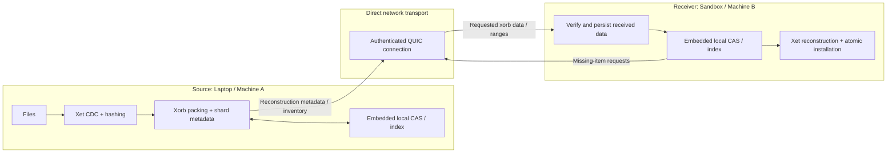
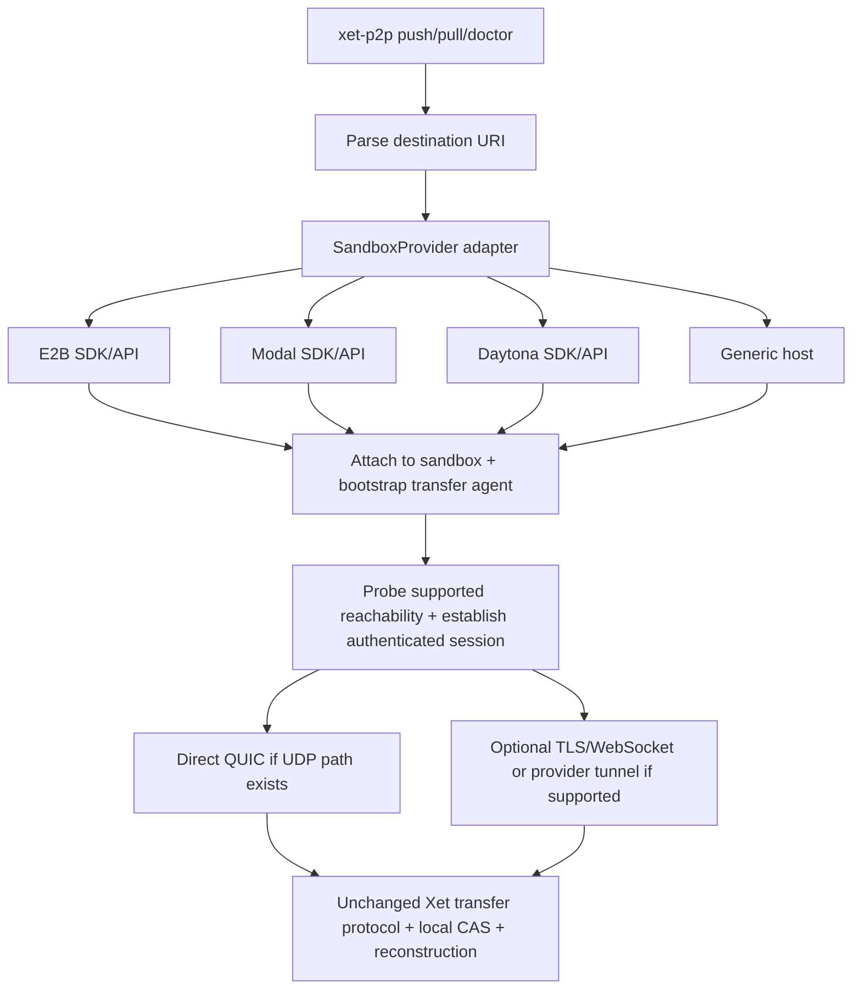

# Xet-over-QUIC: Codex Implementation Brief

**Status:** Initial implementation specification  
**Date:** 31 October 2026  
**Primary language:** Rust  
**Target:** Direct file transfer between one source machine and a known receiver, with provider-agnostic sandbox addressing as a follow-on integration

## 0. Instructions to Codex

Build a **native Xet-based, direct peer-to-peer file transfer utility**. Use Hugging Face's official `xet-core` components for content-defined chunking, hashes, xorbs, shards, deduplication, and reconstruction. Use **Quinn/QUIC** for direct, encrypted communication between the two endpoints. Store content in an **embedded local CAS on each endpoint**.

**Do not introduce a network CAS service.** The receiving peer can run a small QUIC listener as part of this transfer utility; that is **not** a standalone Xet CAS HTTP server. Do not route file data through Hugging Face or another cloud store.

First inspect the current repository and official upstream code, identify usable offline interfaces, and record exact versions/commit pins. If an existing repository is present, preserve its conventions. Work incrementally and keep tests running. Do not silently substitute a custom chunk/xorb/shard format for native Xet compatibility.

### Architectural invariant

> **Xet (Chunks + Xorbs + Shards + Local CAS) ↔ QUIC ↔ Xet (Local CAS + Reconstruction)**

The entire point of this project is **native Xet storage + direct QUIC transfer**. QUIC transports data; the Xet content layer handles hashing, storage, deduplication, and file reconstruction. A future **provider-adapter layer** may bootstrap/attach to an existing remote sandbox (E2B, Modal, Daytona, or generic hosts), without changing the Xet data layer. QUIC is the preferred transport, but provider networking may require an explicitly disclosed compatibility transport.

## 1. Goal and scope

Build a CLI that transfers files and directories directly between two known endpoints, with:

- Xet-native content-defined chunks, xorb objects, and shard/reconstruction metadata.
- A persistent **local content-addressable index and object store**, not a remote CAS API.
- Resumable transfers that avoid re-sending already verified data.
- Incremental transfers that reuse already available chunks, including across prior versions where feasible.
- Authenticated, encrypted QUIC streams for data and small coordination messages.
- Verified, crash-safe reconstruction into the receiver's destination directory.

### Explicitly out of scope for v0.1

- Multi-peer distribution, discovery, swarm scheduling, DHT, trackers, and NAT traversal.
- A separate CAS server, REST CAS API, object-store backend, or Hugging Face account/token dependency for the core transfer path.
- Cloud-managed storage, filesystem mounting, background synchronization daemons.
- Bidirectional conflict resolution, automatic mirroring/deletions, and a distributed filesystem.
- Inventing new Xet object encodings.

The first version assumes **two machines with a reachable UDP path** (e.g., direct network, VPN, or port forwarding); do not assume QUIC itself solves NAT traversal. **Sandbox-provider integration is a later milestone (M5)**, after the core QUIC and local-CAS correctness gates. It may introduce provider SDK credentials for provisioning/attachment only; these are separate from Xet/Hugging Face authentication.

## 2. Component boundaries



**Control path:** Receiver checks its local CAS → identifies missing content → resolves missing chunks to xorb locations using source metadata → requests data **through QUIC** → source reads the requested content → receiver verifies and reconstructs. A local CAS lookup is not a network transfer.

### Responsibilities

| Component | Responsibility | Implementation strategy |
|---|---|---|
| Xet chunker + hashing | CDC boundaries, content hashes, file IDs | Reuse official `xet-core` implementation |
| Xorb encoder/reader | Native compressed chunk containers | Reuse official `xet-core` implementation |
| Shard + recipe engine | Maps files to ordered `(xorb_hash, [start,end))` terms; indexes chunks | Reuse official metadata structures |
| Embedded CAS | Persist xorbs/shards and map chunk hash → available xorb/chunk position | Local disk plus existing shard/index utilities where possible |
| QUIC transport | Authenticated connection, reliable streams, flow control | `quinn` with `tokio` |
| Transfer coordinator | Exchange manifest/inventory/requests/acknowledgements | Small **application-control messages over QUIC**, not a CAS server |
| Reconstructor | Restore exact file bytes; commit atomically | Xet reconstruction routines, temporary files, final verification |

**Important:** Xet's public reference implementation contains client-facing CAS integrations. Some high-level workflows expect a remote CAS. Do **not** assume they work offline unchanged; audit them first and isolate or adapt the storage dependency. Reuse upstream data formats and algorithms rather than reimplementing them.

## 3. Storage model

Each endpoint maintains an application-owned persistent directory (path configurable; below is illustrative):

```text
~/.cache/xet-p2p/
  xorbs/                  # Native serialized Xet xorb objects, keyed by xorb hash
  shards/                 # Native Xet shard objects
  index/                  # Local chunk->xorb and file reconstruction lookup state
  sessions/               # Resumable transfer checkpoints and verified progress
  tmp/                    # Uncommitted writes / staging
```

The local CAS should support operations conceptually equivalent to:

```text
has_chunk(chunk_hash) -> bool
locate_chunk(chunk_hash) -> [xorb_hash, chunk_index, optional offsets]
has_xorb(xorb_hash) -> bool
read_xorb_range(xorb_hash, start_chunk, end_chunk) -> encoded data
commit_verified_xorb(xorb_hash, bytes) -> result
find_reconstruction(file_id) -> ordered Xet terms
```

These names describe required **local operations**, not existing APIs that Codex should assume `xet-core` exports. Prefer `xet-core`'s shard-based lookup facilities; avoid adding an external database service. A local embedded index/database is acceptable if required for persistence, but explain why.

A file path is not a content address. Keep **path metadata** (relative path, type, size, file ID, permissions if supported) separate from Xet's content-addressed objects. The first version should support regular files/directories; explicitly reject unsafe symlinks or defer them.

## 4. End-to-end transfer

### A. Initial transfer to an empty sandbox

1. Source walks the requested files and validates their relative paths.
2. Source uses Xet CDC and hashing to produce chunks, xorb objects, native shards, and reconstruction terms.
3. Source opens an authenticated QUIC connection to the receiving peer.
4. Source sends a small file-tree manifest plus the necessary Xet reconstruction metadata/inventory.
5. Receiver checks its **local** CAS and replies with missing object requests.
6. Source streams requested native xorb objects over QUIC, using bounded parallelism.
7. Receiver validates content and stores the verified objects in its local CAS.
8. Receiver reconstructs files from Xet terms to staging paths, verifies final content and sizes, and atomically installs them.
9. Receiver acknowledges success; session state is durably recorded.

### B. Repeated or incremental transfer

- Receiver compares requested chunk IDs and referenced xorb objects against its local CAS.
- Any referenced content already usable in the receiver's CAS must be reused, not re-downloaded.
- **First working transport milestone:** transfer **whole missing xorbs**. This gives a correct native-Xet round trip and full-xorb reuse.
- **Next optimization:** avoid sending redundant chunks when a source xorb contains chunks that the receiver already has in *different* xorbs. Resolve required xorb chunk ranges and transfer only needed compressed ranges, or selectively repack missing chunks into new native xorbs with an updated, valid reconstruction recipe. Measure the trade-off.

**Correctness caveat:** Possessing a chunk hash does not imply the original source xorb exists locally. A reconstruction term may reference that xorb. Never mark a reconstruction complete unless all its referenced ranges are accessible and verified. Do not treat partial xorb bytes as a complete content-addressed xorb. Support partial-range caching with explicit completeness metadata **or** repack/rewrite recipes using Xet-native structures.

### C. Interrupted transfers

- Persist verified object/range completion atomically.
- On reconnection, exchange a resumable session identity or manifest digest, re-check local CAS, and request only still-missing data.
- Never publish partially reconstructed destination files.

## 5. Minimal QUIC control plane

A small, versioned control protocol **inside QUIC streams** is unavoidable for telling the other peer *what* to transfer. It should **not** replicate Xet's remote CAS HTTP API or object encodings.

Proposed conceptual operations (names are project-defined, not Xet endpoints):

| Message | Meaning |
|---|---|
| `HELLO` | Protocol version, feature flags, transfer/session ID |
| `MANIFEST` | Relative paths, file IDs, sizes, Xet reconstruction references |
| `NEED` | Missing xorb hashes or requested xorb chunk ranges |
| `OBJECT_DATA` | Native xorb bytes or range payload on a data stream |
| `ACK` | Verified object/range committed to local CAS |
| `FINALIZE` | Reconstruct + verify + atomically install files |
| `RESULT` | Success/failure, verified file IDs, counters |

Use one bidirectional control stream and a **bounded** number of data streams per connection. Define bounded frame sizes and versioning. The envelope can use a simple, length-prefixed encoding such as CBOR/serde; **the payload's native Xet object bytes must remain unchanged**. Avoid per-64-KiB-stream overhead: stream xorbs or coalesced ranges.

## 6. CLI design (proposed; not existing commands)

```bash
# Receiver (inside sandbox)
xet-p2p serve --listen 0.0.0.0:4433 --root /workspace --cas-dir /workspace/.xet-p2p/cas \
  --cert ./certs/receiver.crt --key ./certs/receiver.key

# Source (on laptop)
xet-p2p push ./project --to sandbox.example:4433 --dest project \
  --ca-cert ./certs/ca.crt

# Repeat after edits: only missing verified content should be transferred
xet-p2p push ./project --to sandbox.example:4433 --dest project \
  --ca-cert ./certs/ca.crt
```

Credentials/authentication: implement authenticated peers, not just encrypted traffic. Pin/trust the receiving peer certificate and require the receiver to authorize the sender (mTLS or a carefully scoped explicit credential). Never disable TLS certificate verification in production. Keep secrets out of logs.

`--dest` must resolve **inside** the configured `--root`; reject `..`, absolute path escapes, symlink escapes, and other directory traversal. A QUIC listener is required to accept connections, but **a separate CAS network server is not**.

### Provider-agnostic CLI extension (planned for M5)

Use provider-qualified destination/source URIs so the transfer engine never needs provider-specific flags. These are **proposed CLI forms, not implemented commands or guaranteed provider endpoints**:

```bash
# Push to an existing remote sandbox (remote path is interpreted by its adapter)
xet-p2p push ./project e2b://SANDBOX_ID/workspace/project
xet-p2p push ./project modal://SANDBOX_ID/workspace/project
xet-p2p push ./project daytona://SANDBOX_ID/workspace/project

# Direct endpoint remains available
xet-p2p push ./project quic://host.example:4433/workspace/project

# Pull from an existing sandbox
xet-p2p pull modal://SANDBOX_ID/workspace/results ./results

# Inspect connectivity before a transfer
xet-p2p doctor e2b://SANDBOX_ID --transport auto

# Fail rather than falling back from native QUIC
xet-p2p push ./project modal://SANDBOX_ID/workspace/project --transport quic
```

`--transport quic` requires a functioning direct QUIC path and fails clearly when unavailable. `--transport auto` prefers QUIC but may select a separately implemented, authenticated provider-compatible transport (e.g. TLS WebSocket or a provider proxy) and **must print which transport was selected**. Never describe WebSocket/TCP traffic or relayed traffic as direct QUIC/P2P. Provider support must not silently turn the core system into a cloud-CAS upload client. Keep provider authentication distinct from end-to-end transfer authorization.

## 7. Implementation plan (in order)

### M0 — Upstream audit + offline Xet round trip

**Goal:** Prove official Xet data structures can represent a file and reconstruct identical bytes without remote CAS.

1. Inspect current `xet-core` upstream and identify stable Rust APIs for CDC, chunk hashes, xorb serialization, shard creation, shard indexing, and reconstruction.
2. Pin versions/commits and document license/dependency constraints.
3. Implement an **offline** local file → Xet chunks/xorbs/shards → local CAS → same file round trip.
4. Write unit/integration tests for empty, tiny, binary, multi-xorb, and repeated-content files.
5. If a high-level API is coupled to remote CAS, adapt it through a narrow local adapter. Record any unavoidable divergence from upstream.

**Exit gate:** Bit-for-bit correct reconstruction from native Xet storage with no internet access.

### M1 — Direct QUIC push, full-xorb transport

1. Add Quinn endpoint setup with proper peer authentication and certificates.
2. Implement receiver listener and sender CLI.
3. Transfer a manifest and missing **whole xorbs**, followed by shards/reconstruction data.
4. Store and verify objects in the receiver's embedded CAS.
5. Reconstruct an entire directory into staging; verify and atomically commit.

**Exit gate:** A source can push a directory to an empty receiver over localhost UDP, and SHA-256 checksums match on both ends. No external CAS or cloud requests.

### M2 — Incremental transfer + durable resume

1. Add persisted chunk/xorb index and transfer session state.
2. Reuse complete xorbs and already available reconstruction terms.
3. Demonstrate second push of unchanged content sends **zero file-payload bytes** (control messages allowed).
4. Kill an in-progress transfer and prove resume without re-sending committed content.
5. Handle duplicate chunks and concurrent requests safely.

**Exit gate:** Repeat and resume behavior is correct and observable in metrics.

### M3 — True chunk-level transfer optimization

1. Identify missing **chunks**, including when the same chunk exists in different xorbs.
2. Map required data to source xorb chunk ranges; coalesce adjacent requests.
3. Implement a valid native-Xet-compatible strategy for partial range caching **or** re-pack missing chunks and rewrite reconstruction metadata.
4. Validate end-to-end integrity and measure actual wire bytes saved, not just dedup hits.

**Exit gate:** A modified file with highly overlapping content transmits materially less file payload than a naive whole-file upload when the receiver's cache is warm. Report exact benchmark conditions.

### M4 — Performance and reliability

Add parallel stream scheduling/backpressure, optional prefetch, cleanup/GC, configurable bandwidth limits, and benchmark against `rsync` over SSH and an uncached file copy. Tune only after correctness tests pass.

### M5 — Provider-agnostic sandbox CLI integration

**Goal:** Use the same Xet+local-CAS transfer engine with named sandbox instances from multiple providers, without modifying native Xet content formats or requiring an inbound QUIC listener on every provider.

1. Define a minimal `SandboxProvider` adapter that can attach to an **existing** sandbox, locate its root/workspace, detect capabilities, stage/start the receiver agent, and close any temporary session. Adapters use documented SDK/API/CLI facilities and are not responsible for chunking, caching, or wire encoding.
2. Implement a provider URI resolver and `doctor` command; add at least one fake provider and a generic remote-host adapter as test fixtures before vendor integrations.
3. Add E2B and Modal adapters first, followed by Daytona if accessible. Treat each provider's actual exposed endpoint and command execution features as capabilities to probe, not as assumed universal behavior.
4. Prefer authenticated QUIC when a reachable UDP path exists. For restricted networking, support an **optional** authenticated WebSocket/TLS transport (or compatible provider tunnel) behind a common transfer-stream interface. Its presence changes the network transport only, **never** Xet object formats, local CAS semantics, or integrity guarantees.
5. Support `push`, `pull`, reconnect/resume, and target-specific diagnostics. Ensure ephemeral agent state is distinct from persistent CAS state.
6. Gate tests that create billable sandboxes or use credentials behind explicit opt-in; default CI runs only offline/local mocks.

**Exit gate:** The same test tree transfers into at least one E2B and one Modal sandbox when provisioned by the user, and round-trips byte-for-byte with correct transport reporting. When raw UDP is unavailable, `--transport quic` must fail transparently; `--transport auto` may use a clearly labeled fallback. No provider-specific logic enters the Xet engine.

## 8. Required tests and measurements

**Correctness:** empty file, 1-byte file, random binary, repeated runs, many small files, >64-MiB input, Unicode filenames, file rename, changes inserted at file start/middle, modified checkpoint-like binaries, and two files sharing chunks.

**Failure and security:** interrupted connection, process crash, duplicate range request, corrupted xorb, mismatched hash, invalid certificate/credential, oversized metadata frame, malformed shard, unsafe paths, insufficient disk space.

**Metrics to print:** total logical bytes, unique chunk bytes, verified/reused chunks, new xorbs, reused xorbs, transferred payload bytes, wire bytes if available, reconstruction bytes, elapsed time, effective throughput, resume savings.

**Benchmark matrix:** cold receiver vs warm receiver; unchanged second run vs edited files; low and high loss/latency where practical. Compare like-for-like compression, caching, and authentication conditions. Do not claim QUIC is faster without measurement.

## 9. Suggested source layout

```text
Cargo.toml
crates/
  xet-local/             # Offline Xet storage adapter, native xorbs/shards, local CAS
  transport/             # Shared authenticated transfer-stream interface
  transport-quic/        # Quinn endpoints, streams, bounded framing, auth
  transport-websocket/   # Optional provider-compatible TLS transport (M5)
  transfer/              # Manifest coordination, dedup planning, resume, commit
  providers/             # Provider interfaces and sandbox URI resolution (M5)
    e2b/                 # Attach/bootstrap/capabilities only
    modal/               # Attach/bootstrap/capabilities only
    daytona/             # Follow-on integration
    generic/             # Direct host / test adapter
  cli/                   # xet-p2p serve/push/pull/doctor
tests/
  integration/
README.md
```

This is a proposed modularization, not a required upstream structure. If reusing an existing Rust workspace, fit the established layout instead.

## 10. Non-negotiable constraints

1. **Native Xet formats**: Do not replace CDC, xorb encoding, shard encoding, or Xet hashing with incompatible approximations.
2. **Embedded CAS only**: No standalone network CAS server or externally managed storage requirement.
3. **Direct QUIC**: No intermediary storage and no mandatory signaling service for the two known endpoints.
4. **No data loss**: Verify content and commit reconstructed files atomically.
5. **Secure by default**: Validate peer identity, authorize destination paths, and avoid unsafe deserialization or unbounded allocations.
6. **Benchmark honestly**: Full-xorb reuse and chunk-level wire deduplication are different; report them separately.
7. **Stay scoped**: No multi-peer functionality or deployment platform integration in v0.1. Add sandbox-provider adapters only after M0/M1 core gates.

## 11. Definition of done for the initial Codex pass

- [ ] Audited official Xet crates and documented exact reusable interfaces.
- [ ] Native offline Xet round-trip test passes (M0).
- [ ] Direct authenticated QUIC file push works on localhost (M1).
- [ ] Receiver uses an embedded persistent CAS; no separate CAS server is started.
- [ ] Directory contents verify byte-for-byte; failed transfers never expose partial files.
- [ ] `README.md` explains running sender/receiver and security setup.
- [ ] Remaining work for chunk-level network optimization (M3) is clearly documented if not yet implemented.

**Codex: start with M0, then M1.** Implement and test these before attempting M2/M3 or M5 provider support. If native offline Xet reuse proves blocked by an upstream assumption about cloud CAS, stop that portion, explain the precise dependency, and propose the smallest possible adapter—do not silently implement an incompatible format.

## 12. Official references

- Hugging Face Xet reference Rust implementation: https://github.com/huggingface/xet-core
- Xet protocol specification: https://huggingface.co/docs/xet/en/index
- Upload and xorb/shard relationships: https://huggingface.co/docs/xet/en/upload-protocol
- Native xorb format: https://huggingface.co/docs/xet/en/xorb
- Native shard format: https://huggingface.co/docs/xet/en/shard
- Chunk-level deduplication: https://huggingface.co/docs/xet/en/deduplication
- Reconstruction terms: https://huggingface.co/docs/xet/en/file-reconstruction
- Quinn, Rust QUIC: https://github.com/quinn-rs/quinn
- Quinn API documentation: https://docs.rs/quinn/latest/quinn/

Use official Xet docs as the format authority and `xet-core` as the implementation reference. Verify current source APIs instead of relying on names from this planning document.

## 13. Sandbox-provider integration design (M5 detail)

### Design principle: provider adapters are connection/bootstrap only

**Do not fork the content pipeline per provider.** The adapter selects *where and how* to run the same receiver and arrange a network path. The shared transfer engine still handles Xet chunking, xorbs, shards, embedded CAS, requests, checksums, resume, and reconstruction.



This diagram adds a **bootstrap/control integration**, not a centralized CAS or mandatory data relay. For the fallback branch, the provider's network proxy might relay bytes; report that honestly. **The agreed Xet ↔ QUIC ↔ Xet path remains the preferred native design.**

### Narrow provider interface (illustrative, not an existing API)

```rust
// Exact signatures and SDK bindings are Codex design decisions.
trait SandboxProvider {
    // Parse/resolve a known user-supplied sandbox identifier; don't create one implicitly.
    async fn attach(&self, sandbox_id: &str) -> Result<SandboxSession>;
    async fn capabilities(&self, session: &SandboxSession) -> Result<NetworkCapabilities>;
    async fn ensure_agent(&self, session: &SandboxSession, version: &str) -> Result<AgentHandle>;
    async fn initiate_session(&self, session: &SandboxSession, mode: TransportMode)
        -> Result<TransferConnection>;
    async fn close_session(&self, session: SandboxSession) -> Result<()>;
}
```

Keep methods independent of specific Python/TypeScript SDK APIs. If a Rust SDK is unavailable, use a narrow provider-specific helper or documented REST/CLI integration. **`SandboxProvider` does not implement `has_chunk`, `read_xorb_range`, shard operations, or file reconstruction.** Those remain in shared `xet-local`/`transfer` code. The agent itself is the transfer application, not a standalone CAS server.

### Connectivity and fallback policy

| Case | Connection strategy | What we promise |
|---|---|---|
| Receiver has reachable UDP/QUIC endpoint | Laptop initiates QUIC into sandbox | Direct native QUIC path |
| Sandbox can reach laptop over UDP, but cannot accept inbound UDP | Sandbox initiates outbound QUIC to a reachable laptop listener | Native QUIC with reversed connection direction |
| No usable end-to-end UDP, provider exposes a permitted HTTP/WebSocket or TCP tunnel | Optional authenticated TLS/WebSocket-compatible transfer | Same Xet data format, but **not QUIC**; may traverse provider proxy |
| Neither direct QUIC nor an explicit supported fallback exists | Error with diagnostics | Do not silently upload to unrelated cloud storage |

Reversing QUIC direction **does not** eliminate laptop-side NAT/firewall constraints. QUIC does not guarantee hole punching. Do not add relay infrastructure or NAT traversal in M5 unless explicitly scoped in a later design. Never assume any sandbox provider exposes public UDP or unrestricted outbound UDP.

### Source and destination semantics

- Provider URLs identify an **existing sandbox** plus a destination path; provider IDs are opaque. Keep canonical parsing/escaping strict, including Unicode and traversal rejection.
- Resolve remote paths relative to an adapter-established permitted workspace/root. Do not allow `..` traversal, absolute-root escapes, or symlink escapes.
- `push`/`pull` invoke the same Xet engine regardless of provider; URI direction only selects source/destination.
- Bootstrap only a signed, pinned-version receiver executable compatible with the sandbox OS/CPU architecture. Check capabilities before attempting installs or network exposure. Never assume root privileges or a persistent filesystem.
- Prefer a managed per-transfer agent process, not a permanent sandbox daemon. Clean up temporary credentials, open tunnels, and processes without deleting user files or preserved CAS objects.
- **Ephemeral cache:** If the provider destroys the sandbox filesystem, its local CAS disappears unless a separately configured persistent volume is mounted. Do not promise cross-sandbox cache reuse without such storage.

### Security / billing requirements

- Provider credentials authorize **attaching and remote command execution**; independent transfer credentials authorize the Xet receiver session. Use short-lived credentials and bound destination roots.
- Do not copy cloud tokens to the other peer or include credentials in CLI output, telemetry, or logs. Validate server identity for both QUIC and fallback modes.
- No implicit creation/destruction of billable sandbox instances, public listeners, or paid resources. If such actions are supported later, require explicit flags and clear user-facing confirmation.
- The `doctor` command should report: provider, target availability, bootstrap status, OS/architecture compatibility, UDP/TCP/HTTP endpoint support (based on actual checks), chosen transport, and whether any proxy/relay is in the data path.

### Provider integration acceptance tests

1. Fake provider: parse `provider://id/path`, attach, bootstrap mock agent, transfer directory, and clean up session.
2. QUIC-capable receiver: successful `--transport quic` transfer with verified file bytes and resume behavior.
3. UDP-restricted receiver: `--transport quic` fails with an actionable diagnostic; `--transport auto` uses an explicitly configured fallback if one is genuinely supported.
4. E2B/Modal: run opt-in integration tests only with valid credentials and an existing sandbox; verify path safety and that no separate CAS service is launched.
5. Transfer parity: for identical data, CAS and reconstruction outcomes are independent of provider and underlying transport, allowing for different framing/overhead.

## 14. Provider documentation to verify during M5

These are **provider integration references**, not alternative file-transfer libraries:

- E2B documentation: https://e2b.dev/docs
- Modal sandbox networking: https://modal.com/docs/guide/sandbox-networking
- Modal sandbox documentation: https://modal.com/docs/guide/sandbox
- Daytona documentation: https://www.daytona.io/docs/

**Codex:** Validate each provider's currently documented attach/exec/port-exposure methods before committing an adapter. A provider's HTTP or TCP endpoint does not establish UDP reachability. Do not hardcode an unsupported inbound QUIC mode.
